# IRR Companion

**A small companion app for [Incursion Red River](https://store.steampowered.com/app/2116120/): create and
compare AI presets, build console commands without typing them, plan your hideout upgrades and find
resources on the maps.**

One portable `.exe`, nothing to install, nothing written to the game's files.

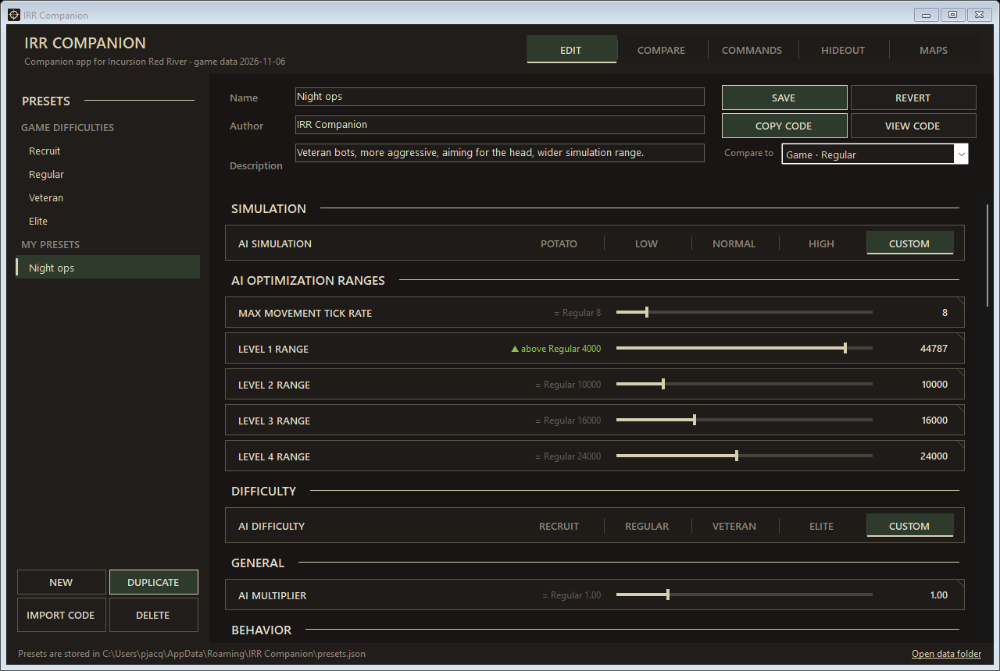

| Tab | What it does |
|---|---|
| **EDIT** | Create AI presets from the game difficulties, with the same settings as the in-game menu, and get the share code to paste in the game. |
| **COMPARE** | Compare two presets setting by setting. |
| **COMMANDS** | Build any of the game's 151 console commands with a few clicks, copy it, keep your favorites. |
| **HIDEOUT** | See the cost of every hideout upgrade with the game icons, track your progress and get a shopping list. |
| **MAPS** | Resource spawn points, extraction points, safes and locked doors (with the key they need) on the game maps. |

## Download

1. Download **`IRRCompanion.exe`** from the [latest release](../../releases/latest).
2. Run it. That's it: no installer, no admin rights.

Requires Windows 10 or 11 (it uses .NET Framework 4.6.2, already part of Windows).

> **Windows SmartScreen:** the exe is not code-signed, so the first launch may show *"Windows protected
> your PC"*. Click **More info → Run anyway**. Every release is built by GitHub Actions from the source in
> this repository; its SHA-256 hash is in the release notes.

## Features

### AI preset editor

- **Every game difficulty built in**: *Recruit, Regular, Veteran, Elite*, and the simulation levels
  *Potato, Low, Normal, High*.
- **The same 35 settings as the in-game AI menu**, in the same sections and order, with the game's
  descriptions as tooltips. Values outside the recommended range turn orange.
- **Advanced settings** (closed by default): the 38 other settings of the game's AI file that the in-game
  menu does not show - finer perception, light and laser detection, trigger delay, deliberate misses,
  suppression, grenades. Click **▶ ADVANCED** at the bottom of the list to open them. The grenade settings
  have the game's own descriptions; the other names and descriptions are ours (written from the game key and
  the difficulty values) and say so in their tooltip.
- **Reference values**: next to each setting, see the value of another preset (▲ above / ▼ below).
- **Custom simulation**: AI optimization ranges and movement tick rate.
- **Share codes**: **COPY CODE** gives an `IRR1-…` code to paste in the game's preset import;
  **IMPORT CODE** reads a code exported by the game or shared by another player.
- **Your presets stay in the app** (`%APPDATA%\IRR Companion\presets.json`). The game only sees what you
  paste into it.

### Compare presets

Pick two presets and see every setting side by side: values, change in value and percent, and a bar showing
both values on the setting's range. Tick *Only differences* to hide what is identical, and *Advanced* to
compare the advanced settings too (the box shows how many of them differ while it is unticked).

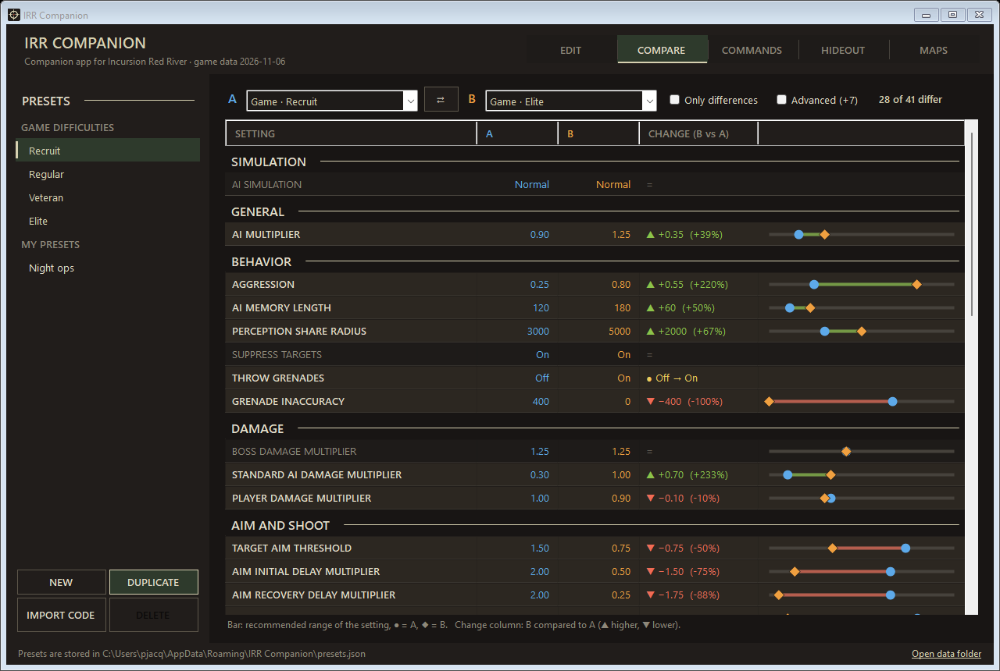

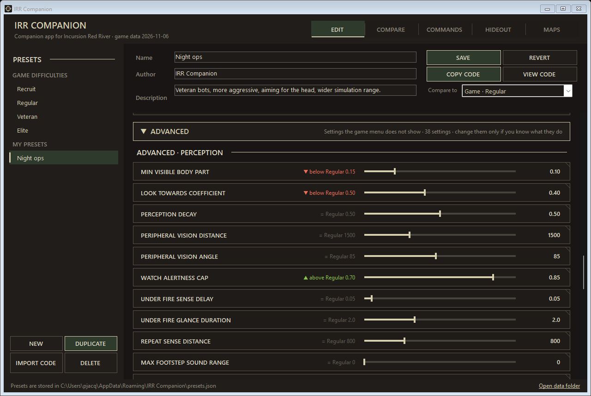

### Console command builder

The **COMMANDS** tab lists the game's `irr.*` console commands (151 of them), with their description:

- **Essentials**: the commands you use while playing - weather, time of day, force extraction, spawn or
  give items, god mode, invisible to AI, infinite ammo, raid timer, kill all AI, free camera…
- **Categories**: World & Raid, Player, Items & Progression, Missions & Operations, AI, Cameras & Menus,
  Graphics & Audio, Debug - plus a search field.
- **A control for each argument**: ON/OFF switches, lists of values, sliders, a map + weather picker (the
  app writes the weather number of that map), and an item picker with the 840 items of the game.
- **COPY** puts the complete command in the clipboard: open the in-game console (`²` / `~`, `^` or `F10`)
  and paste it with `Ctrl+V`.

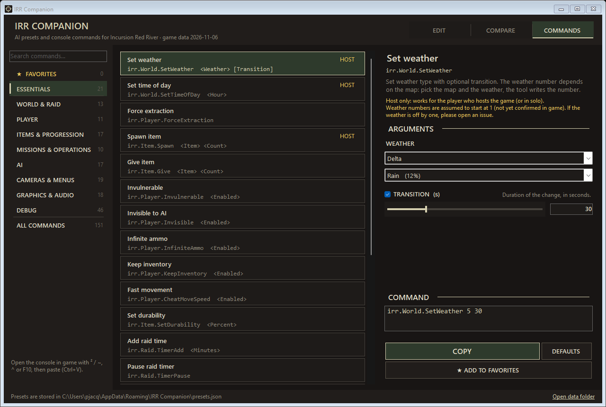

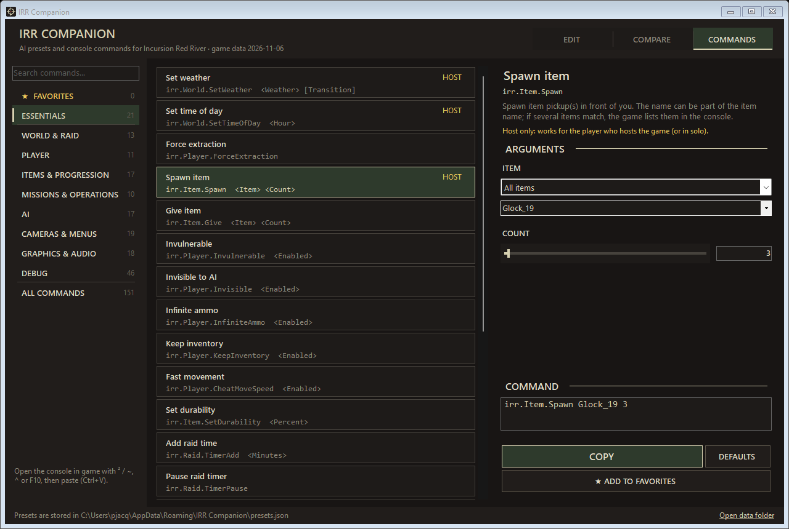

**Favorites**: save a command with its values under your own name ("Thunderstorm on Delta", "Noon"…),
reorder them, and copy them in one click. They are stored in `%APPDATA%\IRR Companion\favorites.json`.

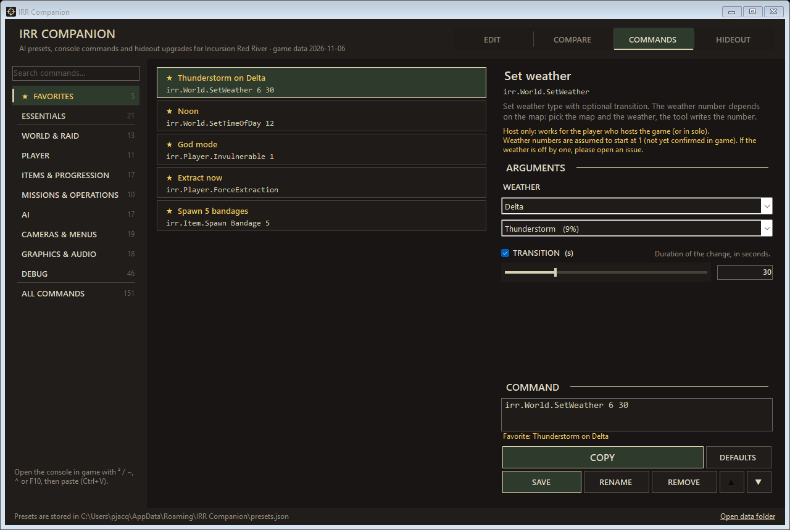

### Hideout upgrades

The **HIDEOUT** tab shows what every level of the 9 hideout units costs - Structure, Generator, Lighting,
Stash, Repair Station, Gunsmith, Terminal, Intel Center, Shooting Range:

- **Items** with their game icon and quantity, **cash** and **materials** (Concrete, Food, Metal, Oil).
- **Requirements**: level of another unit (click it to open that unit), faction loyalty (IGC, UICS, VLF,
  FANG) and player level.
- **Your progress**: set the level of each unit, your player level and your loyalty with each faction. The
  app shows the next upgrade of each unit, with the requirements you meet in green and the missing ones in red.
- **Shopping list**: everything still needed, added up - for the next upgrades only or for all the levels
  left - with the units each item is for.
- **GIVE** buttons copy the matching console command (`irr.Item.Give`, `irr.Item.AddResource`) if you want
  to cheat a little. Your progress is stored in `%APPDATA%\IRR Companion\hideout.json`.

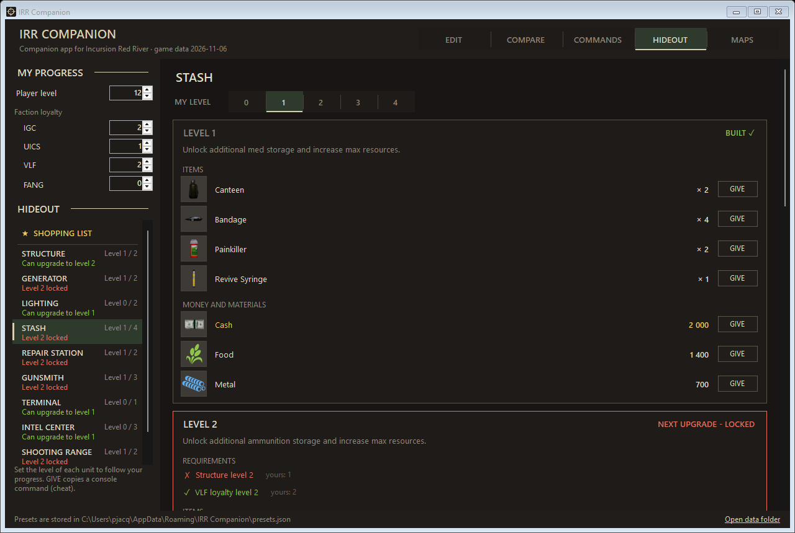

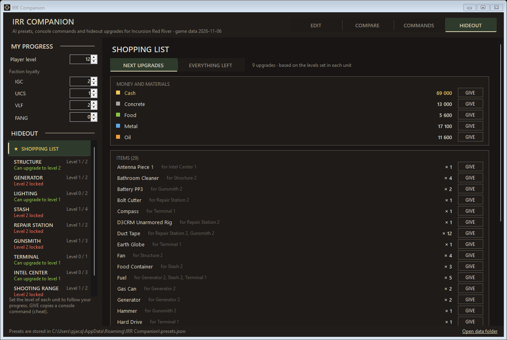

### Resource maps

The **MAPS** tab shows the game's minimaps of **Delta, Quarry, Outskirts and Bunker** with every resource
spawn point placed in the map files, the extraction points, the safes and the locked doors:

- **Filters**: show or hide Concrete, Food, Metal, Oil, extraction points, compact safes, large safes,
  HAS doors and locked doors (with their count).
- **Safes and doors**: hover one to see the key it needs, with the key's icon (e.g. *Outskirts Large Safe Key*,
  *HAS-0410-A key*). Only doors that open with a key are shown.
- **Hover a point**: its type, its chance to be there (**40 %** for every resource point in the game files) and
  the amount you get (700).
- **Average per raid** for the whole map: points x chance, and the units it makes.
- **Bunker**: a floor selector, one plan per floor.
- Mouse wheel to zoom, drag to move, double-click to see the whole map.

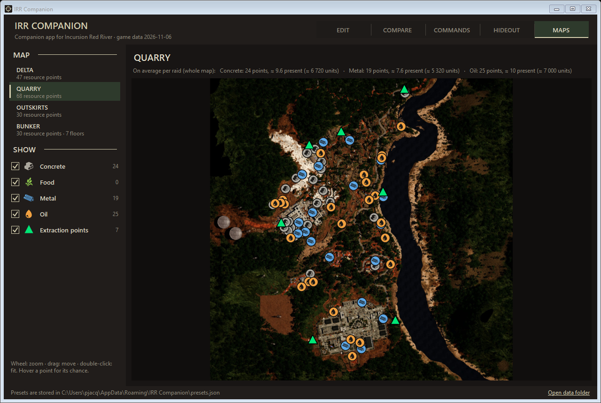

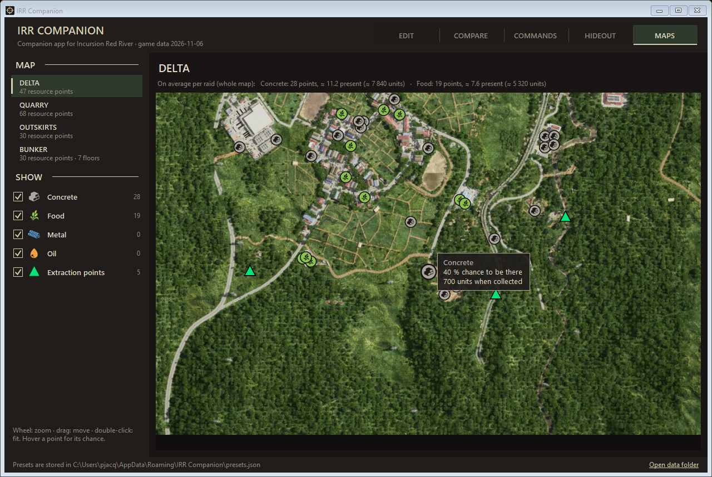

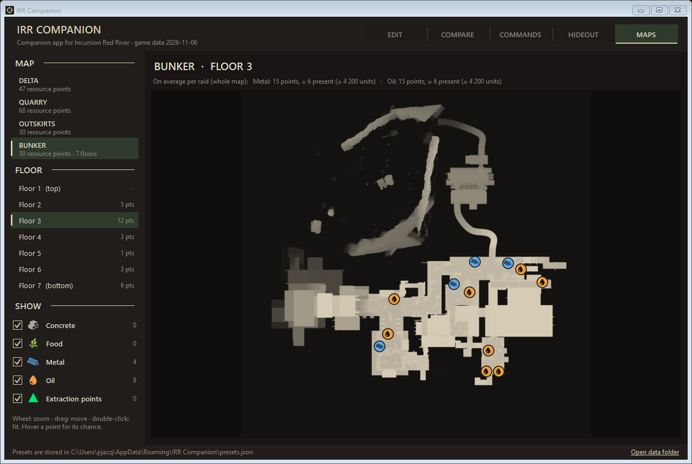

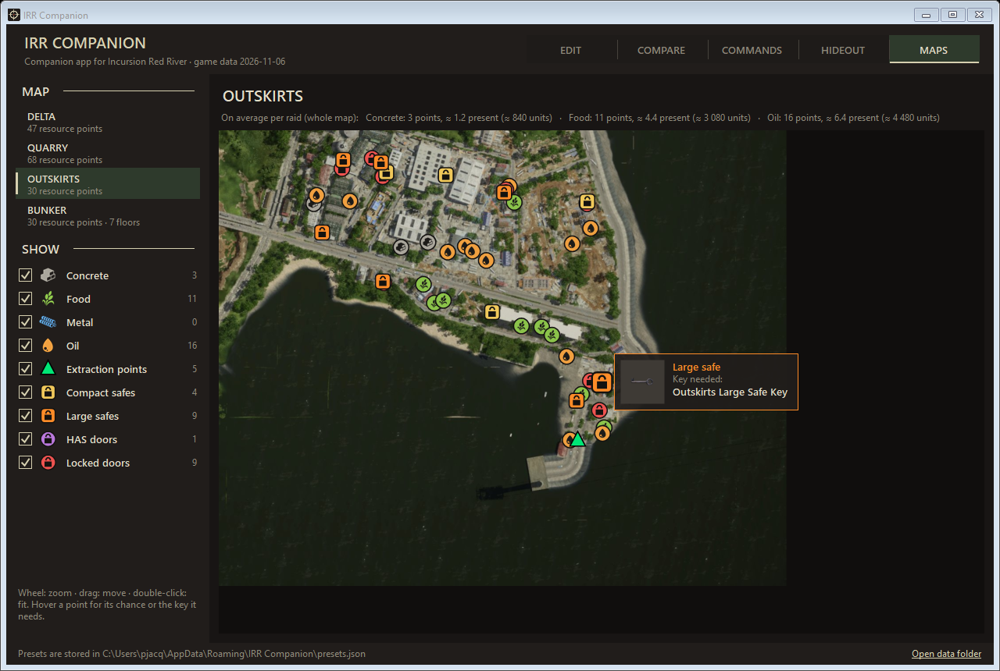

The map placement is the one of the in-game PDA map: centre of the map volume and its *MapSize*.

## How to use

**Make an AI preset**
1. Select a game difficulty and click **DUPLICATE** (or **NEW**).
2. Change the settings, give the preset a name, click **SAVE** (`Ctrl+S`).
3. Click **COPY CODE**, then in the game paste the code in the AI settings preset import.

**Run a console command**
1. Open the **COMMANDS** tab and pick a command (or search for it).
2. Set its arguments on the right and click **COPY** (or double-click the command).
3. In the game, open the console and paste with `Ctrl+V`, then press Enter.

**Plan your hideout**
1. Open the **HIDEOUT** tab and set your player level and faction loyalty on the left.
2. Select each unit and click its current level (**MY LEVEL**). Everything is saved at once.
3. Open **SHOPPING LIST** to see everything you still need to collect.
4. Units marked *Can upgrade* in green meet every requirement; open a unit marked *locked* to see what is
   missing (click a required unit to jump to it).

**Find resources**
1. Open the **MAPS** tab and pick a map (and a floor for the Bunker).
2. Untick what you do not need; hover a resource to see its chance, a safe or a door to see its key.

### Your data

Everything the app saves is in `%APPDATA%\IRR Companion` (the **Open data folder** link at the bottom
right of the window opens it):

| File | Content |
|---|---|
| `presets.json` | your AI presets |
| `favorites.json` | your favorite console commands |
| `hideout.json` | your hideout progress: level of each unit, player level, faction loyalty |

Each file keeps a `.bak` copy of its previous version. Copy this folder to keep a backup or to move your data
to another PC. Users of the former *IRR Preset Tool*:
your presets and favorites are copied from `%APPDATA%\IRR Preset Tool` on the first start.

### After a game update

The app contains data read from a given version of the game (shown in the header: *game data YYYY-MM-DD*).
After a game patch, values, commands or hideout costs may have changed until a new release of the app
updates them. If something differs from the game, please
[open an issue](../../issues).

### Good to know

- `irr.World.SetWeather` takes a number that depends on the map. The numbers are assumed to start at 1;
  this is not confirmed in game yet - if the weather you get is off by one, please open an issue.
- The item names offered for *Spawn item* / *Give item* are the game's internal names; the game also accepts
  part of a name and lists the matches in the console when there are several.
- Commands marked **HOST** only work for the player who hosts the game (or in solo).
- Hideout: the Structure and the Shooting Range have a free level 1 in the game files, taken as their
  starting level; the other units start at level 0 (not built).
- Maps: the 40 % chance is the value set for each resource point in the game files; the game could still
  apply other rules during a raid (a limit per raid, for example) that are not visible in the files.

## For developers

### Building

Requires the .NET SDK 8 or newer (the app itself targets .NET Framework 4.6.2).

```
dotnet build src -c Release
```

The exe is `src/bin/Release/net462/IRRCompanion.exe`. A Debug build adds test helpers:
`--screenshot <prefix>` renders every view to PNG files and `--roundtrip <in> <out>` re-exports a share code.

### Project layout

| Path | Content |
|---|---|
| `src/` | the WinForms app (C# 7.3, .NET Framework 4.6.2): `MainForm.cs` (EDIT / COMPARE), `CommandsPanel.cs`, `HideoutPanel.cs`, `MapsPanel.cs`, data models (`Preset.cs`, `Commands.cs`, `Hideout.cs`, `Maps.cs`), `ShareCode.cs`, `Theme.cs` / `Controls.cs` (dark UI) |
| `src/Resources/` | data generated from the game: `defaults.json`, `commands.json`, `hideout.json`, `maps.json`, `icons/`, `maps/` |
| `tools/` | Python scripts that read the game files and check the app (see below), test share codes in `tools/testdata/` |
| `.claude/skills/update-irr-tool/` | step-by-step procedure to update the app after a game patch |
| `.github/workflows/build.yml` | builds the exe on every push, publishes a release for `v*` tags |
| `docs/` | README screenshots and release notes (`docs/release-notes/<tag>.md`) |

### Updating after a game patch

The app embeds data read from the game. The complete procedure - what to extract, what to check, how to
release - is the Claude Code skill [`.claude/skills/update-irr-tool/SKILL.md`](.claude/skills/update-irr-tool/SKILL.md)
(run `/update-irr-tool` in Claude Code, or follow it by hand). It uses these scripts from `tools/`:

| Script | Output / check |
|---|---|
| `build_defaults.py` | `src/Resources/defaults.json`: difficulties, simulation levels and settings, from the game's `AISettings` folder; prints what changed |
| `check_roundtrip.py` | the share codes in `tools/testdata/` survive an import and export by the app |
| `extract_console.py` | `irr.*` commands of the game exe compared with the app: new and removed ones |
| `ue_param_types.py` | argument types of the game's cheat commands |
| `map_weathers.py` | `tools/map_weathers.json`: weather list of each map |
| `list_items.py` | `tools/item_paths.txt`: the item definitions |
| `build_commands.py` | `src/Resources/commands.json`: commands, weathers and items |
| `build_hideout.py` | `src/Resources/hideout.json`: costs and requirements of every hideout unit level |
| `build_icons.py` | `src/Resources/icons/`: icons of the hideout items, cash and materials (+ `EXTRA_ITEMS`) |
| `build_maps.py` | `src/Resources/maps.json` and `maps/*.jpg`: resource and extraction points, safes and locked doors with their keys, minimaps and their bounds |
| `irr_sharecode.py` | decode / encode share codes from the command line |

Game files are extracted from the paks with [repak](https://github.com/trumank/repak), for example
`repak unpack -o <out> -i "Test_C/Content/AISettings" pakchunk0-Windows.pak`.

### Share code format

`IRR1-` + base64 of the compact JSON document (no `=` padding) + `-` + checksum. The checksum is djb2-xor
(`h = 5381; h = (h * 33) ^ c`, 32-bit) over the base64 text, written as 4 base-36 digits (`0-9A-Z`), least
significant first.

```json
{ "t": "p", "id": "my_preset",
  "preset": { "presetId": "my_preset", "displayName": "My preset", "description": "", "author": "",
              "version": 1, "savedAt": "2026.11.07-13.21.49",
              "selections": { "aISettings": "my_preset", "weapons": "Normal", "barks": "Normal",
                              "simulation": "High", "global": "Normal", "menuStyle": "Normal" } },
  "vars": [ { "c": "AISettings", "n": "my_preset", "hv": 2, "doc": { "...": "..." } } ] }
```

A custom simulation adds `{ "c": "Simulation", "n": "my_preset", "hv": 1, "doc": { … } }` to `vars` and sets
`selections.simulation` to the preset id.

### Releasing

1. Set `<Version>` in `src/IRRCompanion.csproj` and write `docs/release-notes/vX.Y.Z.md` (optional, added at
   the top of the release notes).
2. Push a tag `vX.Y.Z`: the GitHub Actions workflow builds the exe and publishes the release with it and its
   SHA-256 hash.

### Contributing

Issues and pull requests are welcome: wrong values after a game update, a console command that does not
work as described, missing icons, translations… For a game update, the skill above lists every check.

## Status

Known gaps and things still to check in game are listed in [TODO.md](TODO.md).

## Disclaimer

IRR Companion is a fan-made tool, not affiliated with or endorsed by the developers of Incursion Red River.
The default values, descriptions and names in `src/Resources/` come from the game and belong to their owners.
The item and material icons in `src/Resources/icons/` and the minimaps in `src/Resources/maps/` are artwork
from the game, © its developers; they are included only so players recognise the items and places, and will be
removed on request.
The source code is under the MIT license (see [LICENSE](LICENSE)).
